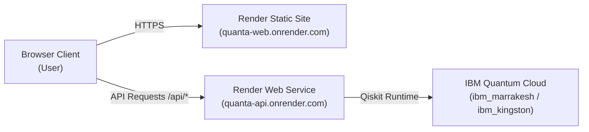

# 🚀 Deploying QUANTA on Render — Step-by-Step Guide

This guide walks you through deploying **QUANTA** on [Render](https://render.com) using either:
* **Option A (Recommended & 100% Free)**: Dual-service architecture (FastAPI Web Service + React Static Site).
* **Option B (All-in-One)**: Single unified Web Service where FastAPI serves both the API and frontend.

---

## 📋 Prerequisites
1. A free account on [Render.com](https://render.com).
2. Your project pushed to a GitHub repository (e.g. `https://github.com/vtu-qiskit-fall-fest-2026/vtu-hc-quantify`).
3. (Optional) Your IBM Quantum API token from [quantum.ibm.com](https://quantum.ibm.com).

---

## ⚡ Option A: Two-Service Deployment (Recommended & Free)

Render provides:
* **1 Free Web Service** for the Python backend.
* **Unlimited Free Static Sites** for the React frontend with global CDN and automatic SSL.



---

### Step 1: Deploy Backend (FastAPI Web Service)

1. Log into your **Render Dashboard** (`https://dashboard.render.com`).
2. Click **New +** $\to$ **Web Service**.
3. Select **Build and deploy from a Git repository**, choose your repository, and click **Connect**.
4. Configure the Web Service settings:

| Field | Value |
|---|---|
| **Name** | `quanta-api` *(or your custom name)* |
| **Region** | Oregon, USA *(or Frankfurt / Singapore)* |
| **Branch** | `main` |
| **Root Directory** | *(Leave blank)* |
| **Runtime** | `Python 3` |
| **Build Command** | `pip install --upgrade pip && pip install -r requirements.txt` |
| **Start Command** | `uvicorn backend.api.main:app --host 0.0.0.0 --port $PORT` |
| **Instance Type** | `Free` |

5. Scroll down to **Environment Variables** and click **Add Environment Variable**:

| Key | Value | Description |
|---|---|---|
| `PYTHON_VERSION` | `3.11.9` | Ensures exact Python 3.11 runtime |
| `QUANTA_MOCK` | `0` | `0` for live CP-SAT & QAOA; `1` for instant fixtures |
| `CORS_ORIGINS` | `*` | Allows cross-origin API calls from frontend |
| `IBM_QUANTUM_TOKEN` | *your_token_here* | *(Optional)* For physical IBM Cloud QPU hardware |

6. Click **Create Web Service**.
7. Wait 2–3 minutes for the build to finish. Once live, Render will give you a public URL:
   `https://quanta-api.onrender.com`
8. Verify it by visiting `https://quanta-api.onrender.com/api/health` in your browser. You should see:
   ```json
   {"status":"ok","mock":false,"version":"1.0.0"}
   ```

---

### Step 2: Deploy Frontend (React + Vite Static Site)

1. In Render Dashboard, click **New +** $\to$ **Static Site**.
2. Connect the same GitHub repository.
3. Configure the Static Site settings:

| Field | Value |
|---|---|
| **Name** | `quanta-web` *(or your custom name)* |
| **Branch** | `main` |
| **Root Directory** | `frontend` |
| **Build Command** | `npm install && npm run build` |
| **Publish Directory** | `dist` |

4. Scroll down to **Environment Variables**:

| Key | Value |
|---|---|
| `VITE_API_URL` | `https://quanta-api.onrender.com/api` *(Your backend URL from Step 1)* |

5. Configure **Redirects / Rewrites** (Essential for Single Page Application navigation):
   * In the left sidebar of the static site, click **Redirects/Rewrites**.
   * Click **Add Rule**:
     * **Type**: `Rewrite`
     * **Source**: `/*`
     * **Destination**: `/index.html`
   * Click **Save**.

6. Click **Create Static Site**.
7. Wait ~1 minute for Vite to build. Once finished, visit your live app at:
   `https://quanta-web.onrender.com`

---

## 📦 Option B: 1-Click Blueprint (`render.yaml`)

We have included a pre-configured [render.yaml](file:///e:/QUANTA/vtu-hc-quantify/render.yaml) at the repository root!

1. In Render Dashboard, click **New +** $\to$ **Blueprint**.
2. Connect your repository.
3. Render will automatically read `render.yaml` and provision both:
   * `quanta-api` (Web Service)
   * `quanta-web` (Static Site)
4. Enter any secret environment variables (like `IBM_QUANTUM_TOKEN`) when prompted.
5. Click **Apply**. Render will build and deploy both services automatically!

---

## 🛡️ Render Free Tier Notes & Pro-Tips

### 1. Handling Cold Starts (Free Tier Inactivity Sleep)
* Render's free tier spins down web services after 15 minutes of inactivity.
* When you open the frontend after a sleep period, the backend may take 30–50 seconds to wake up.
* **Our frontend handles this gracefully**: When waking up, the UI shows a clean loading indicator or toast notification, then automatically syncs as soon as the backend responds.
* **Pro-tip**: You can use a free pinging service (like [UptimeRobot](https://uptimerobot.com) or [Cron-Job.org](https://cron-job.org)) to ping `https://quanta-api.onrender.com/api/health` every 10 minutes to keep it permanently awake!

### 2. Updating Code
* Every time you push a commit to your `main` branch on GitHub:
  ```bash
  git push origin main
  ```
  Render will automatically trigger a rebuild and deploy the new version with zero downtime.

---

## ✅ Deployment Checklist

- [ ] Backend deployed and returns `{"status":"ok"}` at `/api/health`.
- [ ] Frontend deployed and loads Bento Box dashboard at root `/`.
- [ ] `VITE_API_URL` in frontend points to backend URL + `/api`.
- [ ] SPA rewrite rule `/* -> /index.html` configured on Static Site.
- [ ] Dataset page loads demo fixtures and triggers CP-SAT baseline.
- [ ] Cluster Lab displays conflict graph and runs QAOA.
- [ ] Benchmarks page displays IBM Quantum Cloud hardware telemetry.
