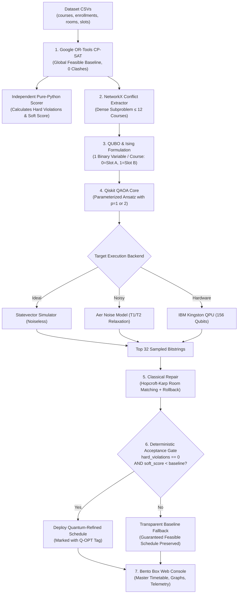

# QUANTA: The Complete Beginner-to-Expert Guide

Welcome to the comprehensive, plain-English guide to **QUANTA** (*Quantum-Assisted Timetabling & Allocation*). This document explains what the project is, why it was built, how every single algorithm and mathematical formula works under the hood, how the code is structured, and how to use the entire application step by step.

---

## 📌 Table of Contents

1. [What is QUANTA in Plain English?](#1-what-is-quanta-in-plain-english)
2. [The Core Philosophy: "Quantum Proposes, Classical Disposes"](#2-the-core-philosophy-quantum-proposes-classical-disposes)
3. [Step-by-Step Pipeline Walkthrough](#3-step-by-step-pipeline-walkthrough)
   - [Step 1: Dataset Ingestion & Validation](#step-1-dataset-ingestion--validation)
   - [Step 2: Classical CP-SAT Baseline & Scorer](#step-2-classical-cp-sat-baseline--scorer)
   - [Step 3: Bottleneck Subproblem Extraction](#step-3-bottleneck-subproblem-extraction)
   - [Step 4: Mapping Conflicts to Quantum (QUBO & Ising)](#step-4-mapping-conflicts-to-quantum-qubo--ising)
   - [Step 5: The Quantum Variational Core (QAOA)](#step-5-the-quantum-variational-core-qaoa)
   - [Step 6: Classical Repair & Deterministic Acceptance Gate](#step-6-classical-repair--deterministic-acceptance-gate)
   - [Step 7: Master Timetable & Telemetry Output](#step-7-master-timetable--telemetry-output)
4. [Code Architecture Tour](#4-code-architecture-tour)
   - [backend/core/ (Classical Engine)](#backendcore-classical-engine)
   - [backend/quantum/ (Quantum Engine)](#backendquantum-quantum-engine)
   - [backend/api/ (REST API & Background Workers)](#backendapi-rest-api--background-workers)
   - [frontend/ (Bento Box Web Console)](#frontend-bento-box-web-console)
   - [benchmarks/ (Comparative Evaluation)](#benchmarks-comparative-evaluation)
5. [End-to-End User Guide: How to Use the System](#5-end-to-end-user-guide-how-to-use-the-system)
   - [1. Starting the Application](#1-starting-the-application)
   - [2. Uploading & Validating Datasets](#2-uploading--validating-datasets)
   - [3. Solving the Classical Baseline](#3-solving-the-classical-baseline)
   - [4. Inspecting the Master Timetable](#4-inspecting-the-master-timetable)
   - [5. Using the Cluster Lab (Hero Screen)](#5-using-the-cluster-lab-hero-screen)
   - [6. Analyzing Benchmarks & IBM Hardware Runs](#6-analyzing-benchmarks--ibm-hardware-runs)
   - [7. Command-Line Workflows](#7-command-line-workflows)
6. [Frequently Asked Questions & Honest Science](#6-frequently-asked-questions--honest-science)

---

## 1. What is QUANTA in Plain English?

### The Real-World Problem
Imagine you are the chief examination coordinator at a university with **4,200 students**, **180 courses**, **22 examination halls**, and **15 available time slots** across an exam week.

Scheduling exams sounds simple, but it is notoriously **NP-hard** (computationally intractable):
1. **Hard Constraints (Zero Tolerance):**
   - **No Clashes:** If Student Alice is enrolled in both *Algorithms* and *Organic Chemistry*, those two exams cannot take place at the same time.
   - **Room Capacity:** If 300 students sit an exam, the total capacity of rooms assigned to that slot must be at least 300 seats.
   - **No Double-Booking:** Hall 101 cannot host two different exams at the same hour.
   - **Complete Coverage:** Every course must have an assigned slot and hall.
2. **Soft Constraints (Student Wellbeing & Fairness):**
   - **Back-to-Back Exams:** Having two exams on the same day one right after the other creates severe mental fatigue.
   - **Overload:** Having 3 exams in a single day is exhausting.
   - **Faculty Balance:** Spread out exams evenly throughout the week.

### Why Existing Methods Fail
- **Pure Classical Solvers (like pure SAT or Integer Linear Programming):** When students take electives across different departments (e.g., Computer Science students taking *Bio-Ethics* or *Financial Economics*), the conflict graph gets tangled in dense knots. Classical solvers can take hours or explode in runtime trying to eliminate soft penalty clumping.
- **Pure Quantum Computers (NISQ Era):** Today's quantum processors (like IBM's Heron processors) have between 100 and 156 qubits. You cannot encode 4,200 students and 180 courses directly onto a quantum chip—it would require tens of thousands of qubits and ultra-deep circuits that get destroyed by hardware noise.

### The QUANTA Solution
Instead of trying to solve the whole university campus on a quantum computer or relying purely on classical heuristics, **QUANTA uses a hybrid division of labor**:
- **Classical computer does what it is great at:** Solve the massive global schedule so that there are **0 hard clashes** across all 4,200 students.
- **Quantum computer does what it is great at:** Zoom into the single nastiest conflict cluster (10 to 12 courses causing student fatigue) and explore combinatorial combinations in quantum superposition to find a cleaner arrangement.
- **Classical safety gate has the final say:** Verify every single quantum suggestion. If the quantum computer produces an error or causes a clash, **reject it instantly and keep the classical baseline**.

---

## 2. The Core Philosophy: "Quantum Proposes, Classical Disposes"

In QUANTA, the quantum computer is **never** given unilateral authority to publish an academic schedule. Its role is strictly an **exploratory candidate generator**.

```text
+---------------------------------------------------------------------------------------------------+
|                                      THE INVARIANT GUARANTEE                                      |
|                                                                                                   |
|  1. Classical CP-SAT establishes a 100% clash-free baseline schedule (Hard Violations = 0).       |
|  2. NetworkX isolates the densest friction bottleneck (≤ 12 courses).                             |
|  3. Qiskit QAOA searches for better slot assignments using quantum superposition.                 |
|  4. Classical repair fixes room assignments and removes collisions.                               |
|  5. Deterministic Acceptance Gate:                                                                |
|     - IF hard_violations == 0 AND soft_score < baseline_score: ACCEPT quantum result.             |
|     - ELSE: FALLBACK to the classical baseline immediately.                                       |
|                                                                                                   |
|  Result: An exam schedule that reaches students is MATHEMATICALLY GUARANTEED to have 0 clashes.   |
+---------------------------------------------------------------------------------------------------+
```

---

## 3. Step-by-Step Pipeline Walkthrough

Here is exactly how data flows through the seven stages of QUANTA from raw CSV files to a finalized exam schedule.



---

### Step 1: Dataset Ingestion & Validation

The pipeline begins with four CSV files representing the university's operational reality:
1. `courses.csv`: `course_id`, `name`, `department`, `duration_minutes`.
2. `enrollments.csv`: `student_id`, `course_id`.
3. `rooms.csv`: `room_id`, `name`, `capacity`.
4. `slots.csv`: `slot_id`, `day`, `order`, `start_time`, `end_time`.

#### Validation Checklist
Before any solver runs, `backend/api/main.py` parses these files with client-side and server-side checks:
- No missing column headers or empty files.
- All student enrollments map to valid `course_id` entries.
- No duplicate student enrollments in the same course.
- No room has a capacity smaller than 20 seats.
- Total examination hall capacity in any slot exceeds peak student load.
- Slot ordering has no discontinuous gaps.

---

### Step 2: Classical CP-SAT Baseline & Scorer

**File:** [backend/core/baseline.py](file:///e:/QUANTA/vtu-hc-quantify/backend/core/baseline.py) & [backend/core/scorer.py](file:///e:/QUANTA/vtu-hc-quantify/backend/core/scorer.py)

We solve the campus-wide problem globally using **Google OR-Tools CP-SAT** (Constraint Programming - Satisfiability).

#### How the CP-SAT Baseline Works:
1. **Decision Variable:** A boolean variable $x_{e, s} \in \{0, 1\}$ indicates whether exam $e$ takes place in slot $s$.
2. **Every exam assigned once:**
   $$\sum_{s \in S} x_{e, s} = 1 \quad \forall e \in E$$
3. **Student clash prohibition:** For every student and every slot $s$, the sum of their enrolled exams in that slot cannot exceed 1:
   $$\sum_{e \in \text{Enrolled}(u)} x_{e, s} \le 1 \quad \forall u, \forall s$$
4. **Room Allocation (Stage 2):** Once slots are decided, exams are assigned to specific rooms using a Best-Fit Decreasing heuristic that fills larger rooms first to minimize hall fragmentation.

#### The Independent Auditor (`scorer.py`):
To prevent algorithmic cheating or circular logic, `backend/core/scorer.py` is written in **pure Python without importing OR-Tools or Qiskit**. It acts as an impartial auditor:
$$\text{Soft Penalty Score} = 10 \cdot (\text{Back-to-Back Count}) + 3 \cdot (\text{3+ Exams in One Day}) + 1 \cdot (\text{2 Exams in One Day})$$
- **Back-to-Back Penalty (Weight = 10):** Student has exams in adjacent slots on the same day (e.g., Slot 1: 09:00–11:00, then Slot 2: 11:30–13:30).
- **Hard Violations Count:** Must be **strictly 0**. If any clash or capacity overflow exists, `hard_violations > 0`.

---

### Step 3: Bottleneck Subproblem Extraction

**File:** [backend/core/extractor.py](file:///e:/QUANTA/vtu-hc-quantify/backend/core/extractor.py)

Now that we have a feasible baseline, we look for where students are suffering from back-to-back testing fatigue.

1. **Graph Construction:** We use **NetworkX** to build a conflict graph where nodes are courses and edge weights represent the count of shared students.
2. **Friction Weighting:** Edges between courses currently scheduled in adjacent same-day slots receive heavy weights ($10 \times \text{shared students}$).
3. **Greedy Cluster Growing:** We seed from the highest-penalty edge and greedily add connected courses that maximize internal friction until reaching a cluster size of $N \le 12\text{–}14$ courses.
4. **Deriving Alternate Candidate Slot $B$:**
   - For every course in the cluster, its baseline slot is called **Slot A**.
   - The extractor searches for an alternate **Candidate Slot B** ($B \neq A$) that has enough spare room capacity and introduces the lowest potential clash penalty with fixed courses outside the cluster.

---

### Step 4: Mapping Conflicts to Quantum (QUBO & Ising)

**File:** [backend/quantum/qubo.py](file:///e:/QUANTA/vtu-hc-quantify/backend/quantum/qubo.py) & [backend/quantum/bitorder.py](file:///e:/QUANTA/vtu-hc-quantify/backend/quantum/bitorder.py)

#### Candidate-Slot Binary Encoding
Instead of trying to assign every course to every possible slot (which would require thousands of variables), we use **Perturbation Encoding**:
- Each course $i$ in the cluster gets **one binary variable** $x_i \in \{0, 1\}$:
  - $x_i = 0 \implies$ Course stays in baseline **Slot A**.
  - $x_i = 1 \implies$ Course moves to candidate **Slot B**.
- A cluster of 12 courses requires **exactly 12 qubits**! This fits comfortably on modern quantum hardware.

#### The QUBO Cost Equation
We build a Quadratic Unconstrained Binary Optimization (QUBO) mathematical function:
$$\min_{x \in \{0,1\}^n} Q(x) = \sum_{i < j} J_{ij} x_i x_j + \sum_i h_i x_i + \text{offset}$$

Where:
- $J_{ij}$ penalizes moving courses $i$ and $j$ to slots where they would clash with each other.
- $h_i$ represents the change in penalty relative to fixed external courses when course $i$ flips to Slot B.
- Penalties: Same-slot hard clash ($P = 1000.0$), adjacent same-day ($P = 10.0$), same-day non-adjacent ($P = 1.0$).

#### Mapping to an Ising Hamiltonian
Quantum mechanics operates on spin systems with Pauli-$Z$ operators ($Z \in \{+1, -1\}$). We map binary variables $x_i \in \{0, 1\}$ to Pauli-$Z$ matrices using the algebraic transformation:
$$x_i \mapsto \frac{I - Z_i}{2}$$

Substituting this into $Q(x)$ yields our **Cost Hamiltonian** $H_C$:
$$H_C = \sum_{i < j} w_{ij} Z_i Z_j + \sum_i c_i Z_i + \text{offset}$$
The ground state (lowest energy eigenvalue) of this Hamiltonian corresponds precisely to the assignment that minimizes student clashes!

#### Bit Ordering Warning (Little-Endian)
Qiskit stores qubits in **little-endian** order (qubit 0 is the rightmost character). In [backend/quantum/bitorder.py](file:///e:/QUANTA/vtu-hc-quantify/backend/quantum/bitorder.py), we normalize all bitstrings so that `bits[i]` always corresponds directly to course $i$:
```python
# bits_to_assignment: bitstring "100" -> x_0=0, x_1=0, x_2=1
def bits_to_assignment(bitstring: str) -> list[int]:
    reversed_bits = list(reversed(bitstring.strip()))
    return [int(b) for b in reversed_bits]
```

---

### Step 5: The Quantum Variational Core (QAOA)

**File:** [backend/quantum/qaoa.py](file:///e:/QUANTA/vtu-hc-quantify/backend/quantum/qaoa.py), [backend/quantum/noise.py](file:///e:/QUANTA/vtu-hc-quantify/backend/quantum/noise.py), [backend/quantum/ibm.py](file:///e:/QUANTA/vtu-hc-quantify/backend/quantum/ibm.py)

The **Quantum Approximate Optimization Algorithm (QAOA)** is a hybrid quantum-classical algorithm. Think of it like tuning a radio dial to find the lowest energy signal.

#### 1. The QAOA Circuit (Ansatz)
We prepare an equal superposition state $|+\rangle^{\otimes n} = H^{\otimes n}|0\rangle$ using Hadamard gates. Then, we alternate two unitary operators across $p$ layers ($p=1$ or $p=2$):
$$|\psi(\vec{\gamma}, \vec{\beta})\rangle = \prod_{k=1}^p e^{-i \beta_k H_M} e^{-i \gamma_k H_C} |+\rangle^{\otimes n}$$
- **Cost Unitary $e^{-i \gamma H_C}$:** Applies phase shifts proportional to the conflict penalties using 2-qubit $ZZ$ rotation gates (`RZZ` or `CX-RZ-CX`).
- **Mixer Unitary $e^{-i \beta H_M}$:** Drives transitions between states using single-qubit $X$ rotations: $H_M = \sum_i X_i$.

#### 2. The Variational Feedback Loop
```text
           +-----------------------------------------------+
           | Classical Optimizer (COBYLA / SPSA)           |
           | Proposes new parameter angles: (gamma, beta)  |
           +-----------------------------------------------+
                             |              ^
                 Parameter   |              | Measured Energy
                 Update      v              | <H_C>
           +-----------------------------------------------+
           | Quantum Circuit Execution                     |
           | Qiskit Estimator evaluates <psi| H_C |psi>    |
           +-----------------------------------------------+
```
1. The classical optimizer proposes parameters $(\vec{\gamma}, \vec{\beta})$.
2. The quantum processor executes the circuit and computes the expectation value $\langle H_C \rangle$.
3. The optimizer adjusts $(\vec{\gamma}, \vec{\beta})$ to drive $\langle H_C \rangle$ toward its minimum.

#### 3. Execution Backends
QUANTA supports three execution environments:
- **`ideal` (Noiseless Simulation):** Evaluates statevectors mathematically using Qiskit's `StatevectorEstimator`.
- **`noisy` (Aer Simulation):** Injects realistic physical error models:
  - Thermal relaxation: $T_1 = 120\,\mu\text{s}$ (longitudinal decay), $T_2 = 90\,\mu\text{s}$ (transverse dephasing).
  - Gate errors: $10^{-3}$ depolarizing error on 1-qubit gates, $10^{-2}$ on 2-qubit CNOT gates.
  - Readout error: $2\%$ bit-flip probability during measurement.
- **`ibm` (Live Superconducting Hardware):** Submits circuits via Qiskit Runtime `SamplerV2` to **IBM Kingston** (156-qubit Heron r2 processor) using level-3 transpilation and dynamical decoupling.

---

### Step 6: Classical Repair & Deterministic Acceptance Gate

**File:** [backend/core/repair.py](file:///e:/QUANTA/vtu-hc-quantify/backend/core/repair.py)

When quantum measurements are collected, we obtain the top 32 sampled bitstrings (e.g., `010011010001`).

```text
Sampled Bitstring:  0  1  0  0  1  1  0  1  0  0  0  1
Course Action:      A  B  A  A  B  B  A  B  A  A  A  B
                    |     |
                    Stay  Move to Candidate Slot B
```

#### Classical Repair Heuristic
Even if a bitstring has low energy, quantum noise or high-density moves could cause a minor room capacity shortfall or a clash.
1. **Hopcroft-Karp Bipartite Matching:** We formulate room assignment for altered slots as a maximum bipartite matching problem between exams and available rooms.
2. **Greedy Rollback:** If any hard violation is detected, the algorithm iteratively flips the moved course whose reversal produces the smallest penalty increase back to its baseline slot $A$.

#### The Invariant Acceptance Gate
The candidate timetable is evaluated by the independent scorer:
$$\text{Is Valid} = (\text{Hard Violations} == 0) \land (\text{Soft Score}_{\text{candidate}} < \text{Soft Score}_{\text{baseline}})$$

- **Decision = `quantum_accepted`:** If valid, the schedule is updated with the quantum moves, tagged with **Q-OPT**, and deployed.
- **Decision = `baseline_fallback`:** If violations occur or the soft score fails to strictly improve, the schedule **transparently reverts to the classical baseline**.

---

### Step 7: Master Timetable & Telemetry Output

The finalized timetable and telemetry are exposed via REST API and rendered in the web console:
- Every examination block has an assigned time, room, and department hue.
- Quantum-resolved courses display a distinctive green accent left edge and a `Q-OPT` badge.
- Telemetry shows the quantum circuit depth, 2-qubit gate count, variational energy history, and the official zero-violation seal.

---

## 4. Code Architecture Tour

QUANTA follows strict modular separation. Here is what each directory and file does:

```text
vtu-hc-quantify/
├── backend/
│   ├── schemas.py           # Pydantic v2 schemas: Timetable, SubProblem, QuantumConfig, FinalDecision
│   ├── core/                # Classical Optimization Engine (Member A)
│   │   ├── datagen.py       # Generates realistic synthetic universities (mini and demo presets)
│   │   ├── baseline.py      # Google OR-Tools CP-SAT global solver
│   │   ├── scorer.py        # Independent pure-Python constraint and penalty auditor
│   │   ├── extractor.py     # NetworkX conflict graph analyzer & bottleneck cluster carver
│   │   └── repair.py        # Hopcroft-Karp bipartite room solver, rollback, & acceptance gate
│   ├── quantum/             # Variational Quantum Algorithms (Member B)
│   │   ├── qubo.py          # QUBO formulation, linear penalty terms, & brute-force solver
│   │   ├── bitorder.py      # Little-endian Qiskit normalization helper
│   │   ├── qaoa.py          # Parameterized QAOA ansatz with COBYLA/SPSA loop
│   │   ├── noise.py         # Qiskit Aer noise models (T1/T2, depolarizing, readout)
│   │   ├── ibm.py           # IBM Quantum QPU runner & FakeAuckland offline fallback
│   │   └── interface.py     # Thread-safe unified run_quantum() facade
│   ├── api/                 # FastAPI Web API (Member A)
│   │   ├── main.py          # REST endpoints, CORS, file validation, & cache loading
│   │   ├── jobs.py          # Background worker queue for long-running optimizations
│   │   └── db.py            # SQLite database models for asynchronous job tracking
│   └── tests/               # 61 automated pytest unit and integration tests
├── frontend/                # Bento Box Web Console (Member C)
│   ├── src/
│   │   ├── pages/           # Dataset, Timetable, ClusterLab, Benchmarks, DesignSystem
│   │   ├── components/      # BentoGrid, Tile, StatTile, PillSegmented, CircleSeal, CodeTile
│   │   ├── api.ts           # Typed API client connecting to FastAPI backend
│   │   ├── types.ts         # TypeScript interfaces mirrored from backend schemas
│   │   └── theme.css        # Mint, sage, deep forest, and ink color tokens
└── benchmarks/              # Comparative Benchmarking Engine
    ├── run_benchmarks.py    # Multi-solver harness (CP-SAT vs Brute Force vs QAOA vs QPU)
    ├── results.csv          # Raw empirical metrics across 10 random seeds
    └── results.md           # Markdown tables with circuit scaling and runtime statistics
```

---

## 5. End-to-End User Guide: How to Use the System

### 1. Starting the Application

#### Option A: Terminal Commands
Ensure your Python virtual environment is active and dependencies are installed.

**Terminal 1 — Backend API:**
```bash
uvicorn backend.api.main:app --reload --port 8000
```

**Terminal 2 — Frontend Console:**
```bash
cd frontend
npm run dev
```

Open your browser to: **[http://localhost:5173](http://localhost:5173)**.

---

### 2. Uploading & Validating Datasets
1. Navigate to the **Dataset** tab (`/`).
2. You will see a fanned drag-and-drop zone. Drag and drop the 4 required CSV files (`courses.csv`, `enrollments.csv`, `rooms.csv`, `slots.csv`) from `data/fixtures/mini/` or your own dataset.
3. The table immediately parses the files and shows file sizes, row counts, and schema chips.
4. The **Validation Checklist** will display 6 green verification checkmarks confirming:
   - Valid headers
   - Student IDs mapped correctly
   - Room capacity $\ge 20$
   - Continuous slot numbering

---

### 3. Solving the Classical Baseline
1. At the bottom of the Dataset page, click the prominent deep green button: **Solve Baseline**.
2. A live timer counts up in milliseconds while Google OR-Tools CP-SAT solves the global campus problem.
3. Once solved, a notification confirms: `Solved in 1.8s · 0 hard violations`.
4. You are automatically navigated to the **Timetable** view.

---

### 4. Inspecting the Master Timetable
1. Navigate to the **Timetable** tab (`/timetable`).
2. **Master Grid:** View exam slots across the top (grouped by day) and rooms as rows on the left.
3. **Department Tints:** Courses are color-coded by faculty (Computer Science, Mathematics, Humanities, etc.).
4. **Day Strip:** Above the grid, a load strip highlights days with high student back-to-back testing friction.
5. **Interactive Conflict Inspector:** Click on any exam block to open the right-side inspector panel:
   - View course enrollment count and room assignment.
   - Inspect students sharing exams with this course and see their penalty ratings.

---

### 5. Using the Cluster Lab (Hero Screen)
The **Cluster Lab** (`/clusters`) is where classical and quantum computing interact:

1. **Select a Cluster:** On the left, choose from the ranked list of conflict bottlenecks (e.g., `Cluster 01: 6 Courses, 45 Students`).
2. **Interactive D3 Conflict Graph:**
   - In the center panel, watch the dynamic force-directed graph settle into place.
   - Node radii reflect student enrollment.
   - Edge thickness reflects shared student clash volume.
   - Toggle the **Before / After** pill at the top-right to watch node colors animate into their quantum-proposed slots!
3. **Configure Quantum Execution:** In the right configuration panel:
   - **Backend:** Select `Simulator` (ideal), `Noisy` (Aer error model), or `IBM QPU` (physical hardware).
   - **QAOA Depth ($p$):** Toggle between $p=1$ and $p=2$.
   - **Optimizer:** Choose `COBYLA` (smooth gradients) or `SPSA` (stochastic noise-resilient).
   - **Shots:** Adjust measurement sample count ($512$ to $4096$).
4. **Run Quantum Optimization:**
   - Click **Run (r)**.
   - Watch the **7-stage pipeline stepper** advance in real time: `Extract` $\rightarrow$ `QUBO` $\rightarrow$ `Circuit` $\rightarrow$ `Optimize` $\rightarrow$ `Sample` $\rightarrow$ `Repair` $\rightarrow$ `Decide`.
   - The live **Recharts Energy Trace** plots variational parameter convergence against the dashed brute-force ground truth energy.
5. **The Decision Tile:**
   - When accepted, the decision tile turns deep forest green with the overlapping **CircleSeal** stating `0 HARD VIOLATIONS GUARANTEED`.
   - The tile reports the score improvement (e.g., `Score improved from 412 to 380 (resolved 18 students)`).
6. **Bitstring Histogram & Diff Table:**
   - Inspect the frequency of top-sampled quantum bitstrings. Feasible strings appear in green; infeasible strings in muted gray.
   - The diff table itemizes exactly which courses moved from Slot A to Slot B.

---

### 6. Analyzing Benchmarks & IBM Hardware Runs
Navigate to the **Benchmarks** tab (`/benchmarks`):
1. **Method Comparison Chart:** Compare approximation ratios across Classical Exact (`brute_force`, `cpsat`), Classical Heuristic (`sim_anneal`), and Quantum (`qaoa_ideal`, `qaoa_noisy`, `qaoa_ibm`).
2. **Circuit Scaling Plots:** Examine how circuit depth and 2-qubit CNOT gates scale as problem size grows from 6 to 12 qubits.
3. **IBM Kingston Hardware Card:** View real execution telemetry from IBM's 156-qubit Heron r2 processor:
   - Transpiled Circuit Depth
   - Physical 2-Qubit ECR/CX Gate Count
   - QPU Queue Time and Execution Duration
   - Job ID linking to raw JSON measurement traces

---

### 7. Command-Line Workflows

For automation, testing, or headless servers:

#### 1. Run Complete Automated Test Suite:
```bash
pytest backend/tests/ -v
```

#### 2. Execute Headless End-to-End Pipeline:
```bash
# Run on mini dataset (12 courses, ideal simulator)
python scripts/e2e.py --dataset mini --backend ideal

# Run on campus demo dataset (180 courses, 4,200 students)
python scripts/e2e.py --dataset demo --backend ideal --time-limit 30
```

#### 3. Submit Jobs to IBM Quantum Hardware:
```bash
# Offline dry run with FakeAuckland
python scripts/submit_hardware.py --fixture subproblem_12 --p 1 --shots 2048 --dry-run

# Live physical execution on IBM Quantum (requires IBM_QUANTUM_TOKEN in .env)
python scripts/submit_hardware.py --fixture subproblem_12 --p 1 --shots 2048
```

#### 4. Run Benchmark Suite:
```bash
python -m benchmarks.run_benchmarks
```

---

## 6. Frequently Asked Questions & Honest Science

### Q: Did QUANTA achieve "Quantum Supremacy" or "Quantum Advantage"?
**Honest Answer:** **No, and no NISQ system does for combinatorial problems at this scale.**  
At $N \le 12$ binary variables, classical CP-SAT and brute-force solvers find the optimal ground state in under **40 milliseconds**, while QAOA takes several seconds. Our benchmarks demonstrate this honestly.

**The Real Achievement of QUANTA:**  
QUANTA solves the **architectural integration problem**. Pure quantum algorithms fail in the real world because NISQ processors cannot enforce 100% hard constraints without errors. QUANTA demonstrates how to deploy quantum algorithms safely into production enterprise workflows by:
1. Decomposing intractable global problems into quantum-sized bottlenecks.
2. Formulating problems as 1-qubit-per-course perturbation moves.
3. Using classical repair heuristics and deterministic fallback gates to guarantee that **zero hard violations can ever reach production**.

### Q: Why not put all 180 courses onto the quantum processor?
A full campus schedule with 180 courses, 15 slots, and 22 rooms requires over **5,000 binary decision variables** in standard timetabling formulations. Today's superconducting quantum processors have ~156 qubits and cannot support circuits of that width and depth without total decoherence. QUANTA's subproblem extractor bridges this gap by isolating only the highest-friction $\le 12$-course subproblems.

### Q: What happens if the IBM Quantum computer crashes or produces noisy garbage?
The **Deterministic Acceptance Gate** handles this automatically. If noise flips bitstrings into invalid configurations that cannot be repaired, or if the candidate score is worse than the baseline, QUANTA logs the hardware telemetry and **reverts to the classical CP-SAT baseline with zero hard clashes**.

---

<div align="center">

**QUANTA** · Team ID `VTU-QFF-HC-0076` · Tier `Both`  
Built with ⚛️ Qiskit & Google OR-Tools for the VTU-Qiskit Fall Fest Hackathon 2026

[⬆ Back to Top](#quanta-the-complete-beginner-to-expert-guide)

</div>
