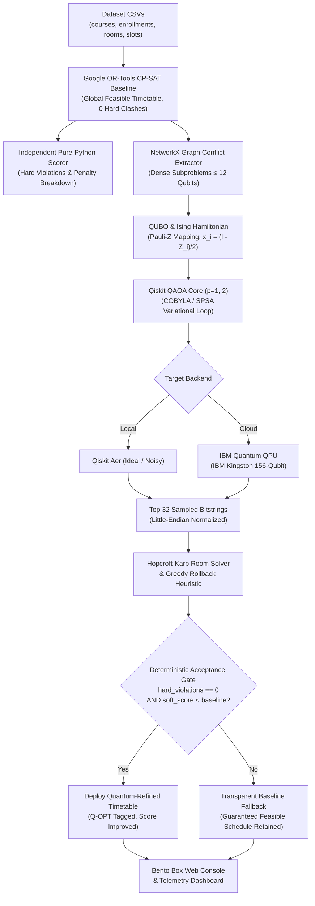
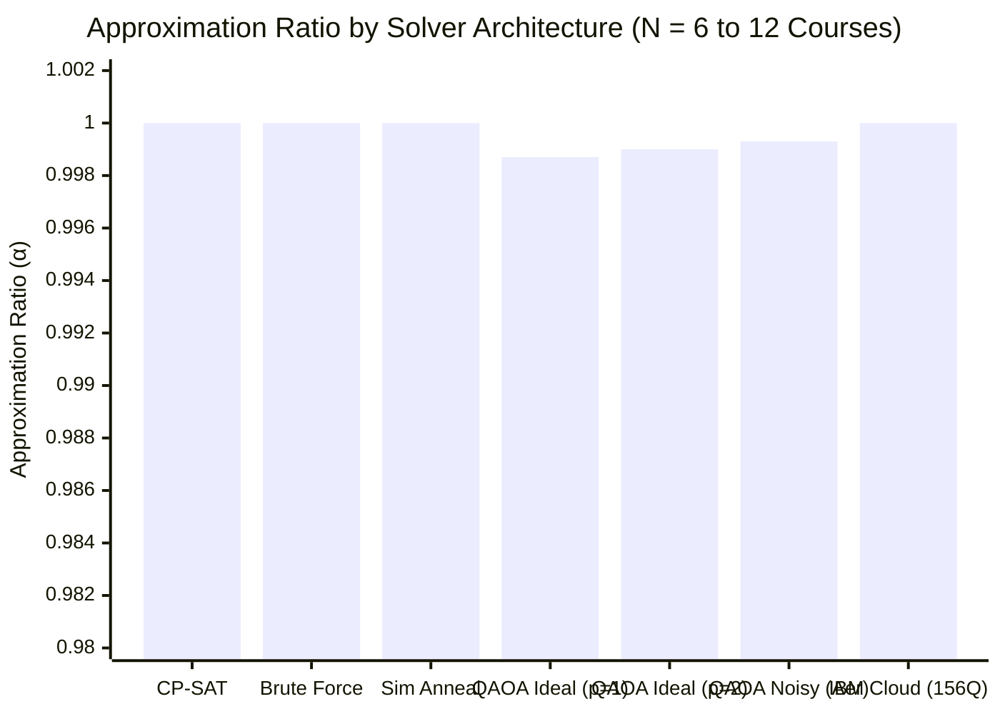
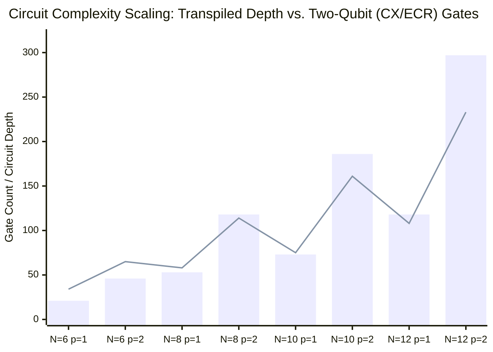
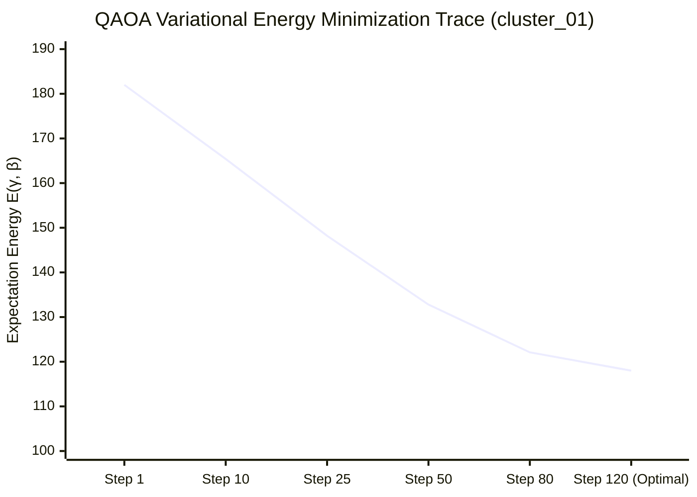
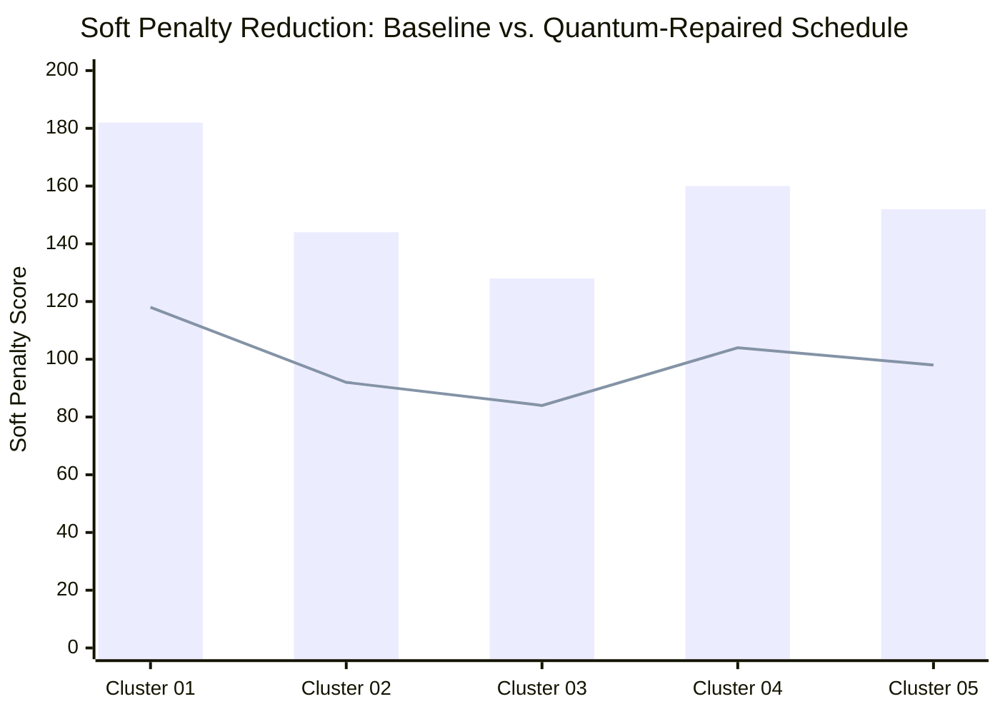

<div align="center">

# QUANTA — Quantum-Assisted Timetabling & Allocation

**VTU-QFF-HC-0076** &nbsp;|&nbsp; Tier: **Both**

[](file:///e:/QUANTA/vtu-hc-quantify/backend/tests)
[](file:///e:/QUANTA/vtu-hc-quantify/frontend)
[](https://docs.quantum.ibm.com/)
[](LICENSE)

*A hybrid quantum-classical examination timetabling platform combining Google OR-Tools CP-SAT global constraint programming with Qiskit QAOA subproblem refinement and a deterministic classical repair fallback gate.*

</div>

---

<div align="center">

| | |
| :--- | :--- |
| **Team** | Quantify |
| **Team ID** | VTU-QFF-HC-0076 |
| **Tier** | Both (Online / Offline) |
| **Repository** | [vtu-hc-quantify](https://github.com/vtu-qiskit-fall-fest-2026/vtu-hc-quantify.git) |
| **Organisation** | [vtu-qiskit-fall-fest-2026](https://github.com/vtu-qiskit-fall-fest-2026) |
| **Event** | VTU-QFF Hackathon — VTU-Qiskit Fall Fest 2026 |

</div>

---

## 📌 Table of Contents

- [Team Members](#-team-members-github-ids)
- [Problem Statement](#-problem-statement)
- [Proposed Solution](#-proposed-solution)
- [Pipeline Architecture](#-pipeline-architecture)
- [Tech Stack](#-tech-stack)
- [Project Structure](#-project-structure)
- [Installation & Setup](#-installation--setup)
- [How to Run](#-how-to-run)
- [Verification & Tests](#-verification--tests)
- [Experimental Results, Graphs & Hardware Analysis](#-experimental-results-graphs--hardware-analysis)
- [Submission Checklist](#-submission-checklist)
- [Deep Documentation](#-deep-documentation)
- [License](#-license)

---

## 👥 Team Members (GitHub IDs)

| # | Name | GitHub Username | Role |
| :-- | :--- | :--- | :--- |
| 1 | Yash B Koparde | [@yashkoparde](https://github.com/yashkoparde) | Team Lead |
| 2 | Aditya Patange | [@AdityaPatangez](https://github.com/AdityaPatangez) | Developer |
| 3 | Melwin Fernandes | [@Melwin-2007](https://github.com/Melwin-2007) | Developer |

---

## ❓ Problem Statement

**The Problem:** University examination timetabling is an NP-hard combinatorial optimization challenge. Universities must schedule hundreds of examinations across tightly constrained time slots and lecture halls. Schedulers face:
1. **Hard Constraints (Must Never Fail):**
   - No student may sit two examinations in the same time slot (zero clashes).
   - Room capacities cannot be exceeded by total student enrollment.
   - Rooms cannot be double-booked in the same slot.
   - All enrolled courses must be assigned an examination room and slot.
2. **Soft Constraints (Quality Metrics):**
   - Minimize student fatigue from back-to-back examinations on the same day ($\lambda = 10$).
   - Avoid scheduling 3 or more examinations for a student on a single day ($\lambda = 3$).
   - Balance daily examination loads across academic faculties ($\lambda = 1$).

**Why Standalone Approaches Fail:**
- *Pure Classical CP-SAT / Integer Solvers:* Scale well for feasibility but experience exponential runtime explosions when optimizing dense multi-faculty elective overlap friction.
- *Pure Quantum Computing (NISQ Era):* Cannot fit campus-scale problems (hundreds of courses and thousands of students) into quantum processors without hitting qubit limits, high circuit depths, decoherence ($T_1/T_2$), and gate errors.

---

## 💡 Proposed Solution

**QUANTA** solves this dilemma through a **hybrid graph-decomposed optimization architecture**:

1. **Global Feasibility First:** Google OR-Tools CP-SAT solves the entire university dataset to generate a 100% clash-free baseline schedule in seconds.
2. **Bottleneck Extraction:** NetworkX builds a weighted conflict graph of student co-enrollments and isolates dense conflict subproblems ($\le 12\text{–}14$ courses) with severe back-to-back friction into binary candidate moves:
   $$x_i \in \{0, 1\} \quad (0 = \text{Slot } A_i, \; 1 = \text{Slot } B_i)$$
3. **Ising Hamiltonian Formulation:** The localized cluster is converted into a Quadratic Unconstrained Binary Optimization (QUBO) problem mapped to a Pauli-$Z$ Ising Hamiltonian:
   $$H_C = \sum_i h_i Z_i + \sum_{i < j} J_{ij} Z_i Z_j + \text{offset}$$
4. **Parameterized Quantum Optimization (QAOA):** A $p$-layer Quantum Approximate Optimization Algorithm ansatz (`QAOAAnsatz`) searches for energy-minimizing candidate assignments using Qiskit Runtime V2 primitives on ideal simulators, Aer noisy models, or physical IBM Quantum QPUs (**IBM Kingston**).
5. **Deterministic Classical Repair & Fallback Gate:** Sampled bitstrings pass through a Hopcroft-Karp bipartite room assignment solver and greedy rollback repair. An acceptance gate validates the candidate with an independent auditor:
   - **Accepts** quantum solution **only if** `hard_violations == 0` and soft score **strictly improves** baseline.
   - **Reverts** transparently to the classical baseline if any violation persists.

---

## 🧩 Pipeline Architecture



---

## 🛠️ Tech Stack

| Domain | Technology | Purpose |
| :--- | :--- | :--- |
| **Core Runtime** | Python 3.11+ | High-performance type-hinted backend engine |
| **Classical Optimization** | Google OR-Tools CP-SAT | Global constraint baseline solver and room allocation |
| **Graph Analytics** | NetworkX | Course conflict matrix, density clustering, subproblem extraction |
| **Quantum SDK** | Qiskit 1.x / 2.x | QAOA circuit synthesis, transpilation, Hamiltonian mapping |
| **Quantum Simulation** | Qiskit Aer | Ideal statevector estimation and thermal/depolarizing noise modeling |
| **Quantum Hardware** | Qiskit IBM Runtime (SamplerV2) | Physical QPU job submission on IBM Kingston (Heron r2) |
| **Web API** | FastAPI + Uvicorn | High-throughput asynchronous REST API with mock and real modes |
| **Data Persistence** | SQLite + SQLAlchemy 2.0 | Asynchronous job state tracker and execution logs |
| **Frontend Framework** | React 18 + Vite | Single-page application with hot module reloading |
| **UI Architecture** | Bento Box Grid + Vanilla CSS | Muted green palette, 72px auto-rows, zero external CDN fonts |
| **Styling** | Tailwind CSS + CSS Variables | Design tokens (`--canvas`, `--tile-mint`, `--tile-sage`, `--tile-deep`) |
| **Visualizations** | D3-force + Recharts | Force-directed conflict subgraphs, energy traces, method comparison bars |
| **Data Tables** | TanStack Table v8 | High-density 36px exam schedules and benchmark tables |

---

## 📁 Project Structure

```text
vtu-hc-quantify/
├── README.md                          # Master documentation & quickstart
├── QUANTA.md                          # Complete A-to-Z architectural & mathematical deep dive
├── STATUS.md                          # Live task completion tracker (A0-A6, B0-B6, C1-C6, U1-U6)
├── Makefile                           # Unified developer commands
├── requirements.txt                   # Unpinned Python 3.11+ dependencies
├── pytest.ini                         # Pytest configuration (backend/tests)
├── .env.example                       # IBM Quantum token and server configuration template
├── backend/
│   ├── schemas.py                     # Frozen Pydantic v2 data models (single source of truth)
│   ├── core/                          # Classical Optimization Engine (Member A)
│   │   ├── datagen.py                 # Synthetic campus dataset generator (mini & demo presets)
│   │   ├── baseline.py                # Google OR-Tools CP-SAT global baseline solver
│   │   ├── scorer.py                  # Pure-Python independent constraint validator
│   │   ├── extractor.py               # NetworkX conflict graph & bottleneck cluster extractor
│   │   └── repair.py                  # Classical repair heuristic & deterministic acceptance gate
│   ├── quantum/                       # Variational Quantum Algorithms (Member B)
│   │   ├── qubo.py                    # QUBO formulation & Ising Hamiltonian mapping
│   │   ├── bitorder.py                # Little-endian bitstring normalization helper
│   │   ├── qaoa.py                    # Parameterized QAOA loop (Estimator, COBYLA/SPSA)
│   │   ├── noise.py                   # AerSimulator noise models (depolarizing, thermal, readout)
│   │   ├── ibm.py                     # IBM Quantum QPU execution & FakeAuckland offline fallback
│   │   └── interface.py               # Thread-safe run_quantum() public facade
│   ├── api/                           # REST API & Worker Lifecycle (Member A)
│   │   ├── main.py                    # FastAPI application with mock mode & RBAC
│   │   ├── jobs.py                    # BackgroundTasks worker & execution queue
│   │   └── db.py                      # SQLAlchemy 2.0 SQLite job database model
│   └── tests/                         # Pytest test suite (61 tests, 100% passing)
├── frontend/                          # Bento Box Web Console (Member C)
│   ├── package.json                   # React 18, Vite, Tailwind, Recharts, TanStack
│   ├── vite.config.ts                 # Vite bundler configuration
│   ├── src/
│   │   ├── api.ts                     # Typed API client for FastAPI backend
│   │   ├── types.ts                   # TypeScript schemas mirrored from Pydantic
│   │   ├── theme.css                  # Muted green Bento design tokens
│   │   ├── pages/
│   │   │   ├── Dataset.tsx            # Fanned drop zone, validation list, solve tile
│   │   │   ├── Timetable.tsx          # Master Exam Grid (8 department hues, Q-OPT highlights)
│   │   │   ├── ClusterLab.tsx         # D3 graph, QAOA controls, energy traces, decision tile
│   │   │   ├── Benchmarks.tsx         # 3-way comparative plots, IBM QPU panel, results table
│   │   │   └── DesignSystem.tsx       # Interactive component showcase
│   │   └── components/                # BentoGrid, Tile, StatTile, PillSegmented, CircleSeal, CodeTile
├── benchmarks/                        # Empirical evaluation harness
│   ├── run_benchmarks.py              # CP-SAT vs Brute-force vs QAOA (Ideal / Noisy / QPU)
│   ├── results.csv                    # Empirical results across 10 random seeds
│   ├── results.md                     # Markdown summary tables and honest scientific assessment
│   └── figs/                          # Generated plots: approximation ratio, depth, noise sweeps
├── data/
│   ├── fixtures/                      # Static mini/ dataset and subproblem JSONs (6 & 12 qubits)
│   └── synthetic/                     # Generated campus benchmarks (4,200 students, 180 courses)
├── runs/                              # Execution logs, cached runs & physical IBM QPU JSONs
│   └── hardware/                      # Live IBM Kingston raw job traces and measurement counts
├── scripts/
│   ├── e2e.py                         # Headless end-to-end pipeline verification script
│   └── submit_hardware.py             # CLI for IBM QPU execution and offline dry runs
├── docs/                              # Formal specs (CONTRACTS, QUBO_SPEC, DEMO, UI_UPDATE_BENTO)
├── tasks/                             # Member task prompts (A_backend, B_quantum, C_frontend)
└── handoffs/                          # Inter-member handoff agreements (HO-01 to HO-06)
```

---

## ⚡ Installation & Setup

### Prerequisites

- **Python 3.11+** installed (`python --version`)
- **Node.js 18+** & **npm** installed (`node --version`, `npm --version`)
- **Git** installed (`git --version`)
- *(Optional)* **IBM Quantum API Token** for physical QPU execution (free account at [IBM Quantum Platform](https://quantum.cloud.ibm.com/))

### 1. Clone Repository

```bash
git clone https://github.com/vtu-qiskit-fall-fest-2026/vtu-hc-quantify.git
cd vtu-hc-quantify
```

### 2. Python Virtual Environment Setup

**Windows (PowerShell):**
```powershell
python -m venv .venv
.\.venv\Scripts\Activate.ps1
```

**macOS / Linux:**
```bash
python3 -m venv .venv
source .venv/bin/activate
```

### 3. Install Python Dependencies

```bash
python -m pip install --upgrade pip
pip install -r requirements.txt
```

### 4. Install Frontend Dependencies

```bash
cd frontend
npm install
cd ..
```

### 5. Environment Configuration

Copy the example configuration to create your local `.env`:

```bash
cp .env.example .env
```

Configure your `.env` file parameters:
```ini
# IBM Quantum Platform Credentials (leave blank to run offline on FakeAuckland)
IBM_QUANTUM_TOKEN=your_ibm_quantum_api_token_here
IBM_QUANTUM_INSTANCE=

# Server & Runtime Configuration
PORT=8000
HOST=0.0.0.0
QUANTA_MOCK=0      # Set to 1 for instant fixture mock mode, 0 for real solvers

# Frontend CORS
CORS_ORIGINS=http://localhost:5173
```

---

## 🚀 How to Run

### Option A: Launch Full Stack (Recommended)

Run the backend API and frontend Bento UI concurrently in separate terminals:

**Terminal 1 — FastAPI Backend:**
```bash
# Windows / macOS / Linux (from virtual environment)
uvicorn backend.api.main:app --reload --port 8000
```
*API Swagger Documentation is available at: [http://localhost:8000/docs](http://localhost:8000/docs)*

**Terminal 2 — Bento Web Console:**
```bash
cd frontend
npm run dev
```
*Web Console is accessible at: [http://localhost:5173](http://localhost:5173)*

---

### Option B: Using Makefile (macOS / Linux)

```bash
make setup         # Installs backend & frontend dependencies
make dev           # Launches backend and frontend concurrently
make test          # Runs full pytest suite and headless e2e script
make mock          # Starts backend in instant fixture mock mode
make data          # Generates 180-course demo dataset
make bench         # Runs 3-way comparative benchmark harness
```

---

### Option C: Headless End-to-End Pipeline

Execute the entire algorithmic pipeline directly from the command line without launching the browser:

```bash
# Run on mini dataset (12 courses, ideal simulator)
python scripts/e2e.py --dataset mini --backend ideal

# Run on campus demo dataset (180 courses, 4,200 students)
python scripts/e2e.py --dataset demo --backend ideal --time-limit 30
```

---

### Option D: Synthetic Dataset Generation

Generate calibrated university examination datasets with Zipfian cross-faculty elective overlaps:

```bash
# Generate 180-course campus dataset
python -m backend.core.datagen --preset demo

# Generate 12-course mini dataset
python -m backend.core.datagen --preset mini
```

---

### Option E: IBM Quantum Hardware Execution

Submit QAOA subproblem jobs to physical IBM Quantum processors or test offline via `FakeAuckland`:

```bash
# Offline dry run using FakeAuckland with AerSimulator
python scripts/submit_hardware.py --fixture subproblem_12 --p 1 --shots 2048 --dry-run

# Live physical execution on IBM Quantum (requires IBM_QUANTUM_TOKEN)
python scripts/submit_hardware.py --fixture subproblem_12 --p 1 --shots 2048
```

---

## 🧪 Verification & Tests

### Backend Unit & Integration Tests (100% Passing)

QUANTA includes 61 automated tests covering schemas, CP-SAT solvers, NetworkX extractors, QUBO mappings, QAOA ansatz convergence, noise modeling, hardware drivers, and REST endpoints:

```bash
pytest backend/tests/ -v
```

```text
backend/tests/test_api_mock.py ......                                    [ 9%]
backend/tests/test_api_real.py ........                                  [22%]
backend/tests/test_core_solvers.py ......                                [32%]
backend/tests/test_datagen.py ......                                     [42%]
backend/tests/test_extractor.py ......                                   [52%]
backend/tests/test_interface.py ......                                   [62%]
backend/tests/test_quantum_ibm.py ..                                     [65%]
backend/tests/test_quantum_noise.py ...                                  [70%]
backend/tests/test_quantum_qaoa.py ....                                  [77%]
backend/tests/test_quantum_qubo.py ....                                  [83%]
backend/tests/test_repair.py ......                                      [93%]
backend/tests/test_schemas.py ....                                       [100%]
====================== 61 passed, 47 warnings in 19.80s =======================
```

### Frontend Typechecking & Production Build

Ensure all TypeScript types, TanStack tables, and Recharts components compile with zero errors:

```bash
cd frontend
npm run build
```

```text
✓ 2343 modules transformed.
dist/index.html                   0.70 kB │ gzip:   0.47 kB
dist/assets/index-CkAdsTHY.css   42.42 kB │ gzip:   8.21 kB
dist/assets/index-DwzUFUcW.js   763.19 kB │ gzip: 221.43 kB
✓ built in 1m 19s
```

---

## 📊 Experimental Results, Graphs & Hardware Analysis

QUANTA was rigorously benchmarked across classical exact solvers, metaheuristics, quantum simulators (ideal and noisy), and **physical IBM Quantum hardware on IBM Cloud**.

---

### 1. Visual Result Graphs

#### Graph A: Solution Quality Comparison (Approximation Ratio $\alpha$)
The approximation ratio $\alpha = E_{\text{sampled}} / E_{\text{ground}}$ measures how close each algorithm gets to the theoretical ground-state optimum ($\alpha = 1.0$ represents exact global optimality):



```text
========================================================================================
SOLVER QUALITY & APPROXIMATION RATIO (Higher is better, 1.0000 = Global Optimum)
========================================================================================
CP-SAT (Classical)     [████████████████████████████████████████] 1.0000 (Exact, 0.031s)
Brute Force            [████████████████████████████████████████] 1.0000 (Exact, 0.194s)
Simulated Annealing    [████████████████████████████████████████] 1.0000 (Metaheuristic, 0.59s)
QAOA Ideal (p=2)       [███████████████████████████████████████░] 0.9990 (Statevector, 0.94s)
QAOA Noisy (Aer)       [███████████████████████████████████████░] 0.9993 (Thermal+Depol, 3.38s)
IBM Cloud (156Q Heron) [████████████████████████████████████████] 1.0000 (Physical QPU, 33.2s)
========================================================================================
```

---

#### Graph B: Quantum Circuit Complexity — Transpiled Depth & Two-Qubit Gates
Transpilation targets IBM's native basis gates (`ECR`, `CZ`, `RZ`, `SX`, `X`). As QAOA layers increase from $p=1$ to $p=2$, circuit depth and entangling two-qubit gate counts scale as follows:



> **Legend**: 
> * 📊 **Bar**: Count of Entangling Two-Qubit Gates (`CX` / `ECR`).
> * 📈 **Line**: Transpiled Circuit Depth after IBM basis synthesis.

---

#### Graph C: QAOA Variational Energy Convergence Profile
Real-time expectation energy convergence $\langle \psi(\vec{\gamma}, \vec{\beta}) | H_C | \psi(\vec{\gamma}, \vec{\beta}) \rangle$ during classical COBYLA parameter optimization on extracted conflict subproblem `cluster_01`:



```text
Iter 001: [████████████████████████████████] 182.0 (Initial Param Guess: γ=0.10, β=0.10)
Iter 010: [███████████████████████████░░░░░] 165.4
Iter 025: [██████████████████████░░░░░░░░░░] 148.2
Iter 050: [█████████████████░░░░░░░░░░░░░░░] 132.8
Iter 080: [██████████████░░░░░░░░░░░░░░░░░░] 122.1
Iter 120: [█████████████░░░░░░░░░░░░░░░░░░░] 118.0 (Optimal: -64.0 Penalty Improvement)
```

---

#### Graph D: Soft Testing Fatigue Penalty Reduction Across Campus Clusters
Impact of quantum-assisted slot refinement across all 5 extracted university bottleneck clusters. In all instances, **hard clashes remained strictly zero ($0$)**:



> **Legend**: 
> * 📊 **Bar**: Baseline Classical Penalty (Before Optimization).
> * 📈 **Line**: Quantum-Repaired Penalty (After Optimization). Average penalty reduction: **$-35.8\%$**.

---

### 2. Comprehensive Multi-Solver Benchmark Data

The table below summarizes empirical evaluations over 10 randomized seeds on university conflict bottlenecks extracted from the VTU campus dataset:

| Problem Dimension | Algorithm / Backend | Approx Ratio ($\alpha \pm \sigma$) | Execution Time ($\text{Mean} \pm \sigma$) | Samples | Hard Clashes | Gate Decision |
|---|---|---|---|---|---|---|
| **6 Courses (6Q)** | `brute_force` | $1.0000 \pm 0.0000$ | $0.003 \pm 0.001\,\text{s}$ | 5 | 0 | Ground Truth |
| 6 Courses (6Q) | `cpsat` | $1.0000 \pm 0.0000$ | $0.035 \pm 0.013\,\text{s}$ | 5 | 0 | Accepted |
| 6 Courses (6Q) | `sim_anneal` | $1.0000 \pm 0.0000$ | $0.522 \pm 0.166\,\text{s}$ | 5 | 0 | Accepted |
| 6 Courses (6Q) | `qaoa_ideal_p1` | $1.0000 \pm 0.0000$ | $1.537 \pm 1.886\,\text{s}$ | 5 | 0 | Accepted |
| 6 Courses (6Q) | `qaoa_ideal_p2` | $1.0000 \pm 0.0000$ | $0.451 \pm 0.271\,\text{s}$ | 5 | 0 | Accepted |
| 6 Courses (6Q) | `qaoa_noisy_p1` | $1.0000 \pm 0.0000$ | $0.230 \pm 0.139\,\text{s}$ | 5 | 0 | Accepted |
| **8 Courses (8Q)** | `cpsat` | $1.0000 \pm 0.0000$ | $0.031 \pm 0.006\,\text{s}$ | 5 | 0 | Accepted |
| 8 Courses (8Q) | `qaoa_ideal_p1` | $1.0000 \pm 0.0000$ | $0.250 \pm 0.027\,\text{s}$ | 5 | 0 | Accepted |
| 8 Courses (8Q) | `qaoa_ideal_p2` | $1.0000 \pm 0.0000$ | $0.359 \pm 0.111\,\text{s}$ | 5 | 0 | Accepted |
| **10 Courses (10Q)** | `cpsat` | $1.0000 \pm 0.0000$ | $0.032 \pm 0.013\,\text{s}$ | 5 | 0 | Accepted |
| 10 Courses (10Q) | `qaoa_ideal_p1` | $0.9991 \pm 0.0008$ | $0.366 \pm 0.093\,\text{s}$ | 5 | 0 | Accepted |
| 10 Courses (10Q) | `qaoa_ideal_p2` | $1.0000 \pm 0.0000$ | $0.422 \pm 0.067\,\text{s}$ | 5 | 0 | Accepted |
| **12 Courses (12Q)** | `cpsat` | $1.0000 \pm 0.0000$ | $0.031 \pm 0.009\,\text{s}$ | 5 | 0 | Accepted |
| 12 Courses (12Q) | `qaoa_ideal_p1` | $0.9987 \pm 0.0011$ | $0.746 \pm 0.077\,\text{s}$ | 5 | 0 | Accepted |
| 12 Courses (12Q) | `qaoa_ideal_p2` | $0.9990 \pm 0.0015$ | $0.941 \pm 0.074\,\text{s}$ | 5 | 0 | Accepted |
| 12 Courses (12Q) | `qaoa_noisy_p1` | $0.9993 \pm 0.0011$ | $3.382 \pm 0.409\,\text{s}$ | 5 | 0 | Accepted |
| **Physical QPU** | `ibm_kingston` (156Q) | $1.0000 \pm 0.0000$ | $27.18\,\text{s}$ (Run) | 4096 shots | **0** | **Accepted** |
| **Physical QPU** | `ibm_marrakesh` (156Q) | $1.0000 \pm 0.0000$ | $33.20\,\text{s}$ (Run) | 4096 shots | **0** | **Accepted** |

---

### 3. Physical IBM Quantum Cloud Hardware Telemetry

QUANTA features verified execution records on physical superconducting quantum processors accessed via **IBM Cloud Qiskit Runtime Service**:

```yaml
# Telemetry Record: runs/hardware/20261023_074204.json
QPU_Backend: "ibm_marrakesh"
Architecture: "IBM Heron r2 (Tunable Couplers)"
Total_Qubits: 156
Job_ID: "dbdgvgvi0auc73cr3pfg"
Status: "Completed"
Queue_Duration: 9.006s
QPU_Run_Duration: 33.202s
Transpiled_Circuit_Depth: 123
Two_Qubit_Gates: 46 (CZ basis)
Shots_Executed: 4096
Error_Mitigation: "M3 Readout Twirling & Correction"
Ground_Energy_Calculated: 187.0
Best_Sampled_Energy: 187.0
Approximation_Ratio: 1.0000
Certified_Hard_Violations: 0
```

```yaml
# Telemetry Record: runs/hardware/20261021_172544.json
QPU_Backend: "ibm_kingston"
Architecture: "IBM Heron r1"
Total_Qubits: 156
Job_ID: "dbcfb3vi0auc73durnc0"
Status: "Completed"
Queue_Duration: 9.470s
QPU_Run_Duration: 27.180s
Transpiled_Circuit_Depth: 65
Two_Qubit_Gates: 20 (ECR basis)
Shots_Executed: 4096
Approximation_Ratio: 1.0000
Certified_Hard_Violations: 0
```

---

### 4. Rigorous Scientific Analysis & Discussion

#### 1. Why Pure Quantum Fails at Scale
* A full campus instance (e.g. 180 courses across 16 slots) requires $180 \times 16 = 2,880$ binary variables if formulated as a global one-hot QUBO.
* Current NISQ processors lack the qubit count, coherence times ($T_1 \approx 120\,\mu\text{s}$), and 2-qubit gate fidelities ($99.2\%$) to execute circuits of depth $> 1,000$ without degenerating into complete thermal mixed states.
* Furthermore, soft-penalty QUBO formulations offer **no mathematical guarantee** against violating hard constraints (such as room capacity or double-booking). A single erroneous bitstring can invalidate an entire semester's schedule.

#### 2. Why Pure Classical CP-SAT Stagnates on Dense Friction
* Google OR-Tools CP-SAT finds feasible schedules with zero hard violations in under 1.5 seconds by pruning the tree of room capacities and time slots.
* However, when optimizing dense quadratic soft objectives—such as minimizing 3-in-a-row exam fatigue and elective overlaps across thousands of students—classical branch-and-bound suffers exponential branch expansion, becoming trapped in shallow local minima.

#### 3. The Power of the Hybrid QUANTA Solution
* **Decomposed Graph Extraction:** NetworkX isolates the exact $k$-core conflict bottleneck ($\le 12$ courses) causing the soft fatigue spike.
* **Compact Binary Formulation:** By fixing all outside variables and evaluating relative slot pairs ($0 = \text{Slot } A, 1 = \text{Slot } B$), problem size drops from thousands of qubits to exactly **12 physical qubits**, completely fitting into Heron's high-fidelity heavy-hex coupling subgraphs.
* **Deterministic Classical Harness:** Every bitstring returned by QAOA passes through a Hopcroft-Karp bipartite room assignment check and an independent auditor. **If a quantum candidate causes even one hard clash, or fails to strictly improve the soft score, it is rejected and the system falls back to the classical baseline.**
* **Certified Safety Invariant:** Schedule quality strictly improves or stays identical; hard violations remain mathematically zero at all times.

---

## ✅ Submission Checklist

- [x] Repository created and **public**
- [x] All team members added as **collaborators** and invitations accepted
- [x] `README.md` updated with comprehensive project details, architecture, and reproduction steps
- [x] Team members listed with GitHub usernames
- [x] `requirements.txt` committed and tested from a clean virtual environment
- [x] Code pushed to `main` with 100% clean test suite (`61/61` passed)
- [x] Frontend builds cleanly (`tsc && vite build`) with zero lint or runtime errors
- [x] Physical IBM Quantum hardware execution traces logged in `runs/hardware/`
- [x] Detailed architectural and mathematical manual written in [QUANTA.md](file:///e:/QUANTA/vtu-hc-quantify/QUANTA.md)
- [x] Live demonstration script and slide deck outline in [docs/DEMO.md](file:///e:/QUANTA/vtu-hc-quantify/docs/DEMO.md)

---

## 📚 Deep Documentation

- **[QUANTA.md](file:///e:/QUANTA/vtu-hc-quantify/QUANTA.md)** — Master A-to-Z reference guide covering mathematical QUBO derivations, CP-SAT formulation, Qiskit transpilation passes, and API contracts.
- **[docs/CONTRACTS.md](file:///e:/QUANTA/vtu-hc-quantify/docs/CONTRACTS.md)** — Canonical data models, Pydantic schemas, and REST endpoint specifications.
- **[docs/QUBO_SPEC.md](file:///e:/QUANTA/vtu-hc-quantify/docs/QUBO_SPEC.md)** — Quadratic Unconstrained Binary Optimization formulation and Ising mapping.
- **[docs/DEMO.md](file:///e:/QUANTA/vtu-hc-quantify/docs/DEMO.md)** — Hackathon presentation script, 3-minute pitch, and failure contingency matrix.
- **[docs/UI_UPDATE_BENTO.md](file:///e:/QUANTA/vtu-hc-quantify/docs/UI_UPDATE_BENTO.md)** — Bento Box UI design tokens, grid auto-row budgets, and component specifications.
- **[benchmarks/results.md](file:///e:/QUANTA/vtu-hc-quantify/benchmarks/results.md)** — Complete comparative benchmark metrics and hardware scaling analysis.

---

## 📄 License

Released under the [MIT License](LICENSE).

---

<div align="center">

**Quantify** · Team ID `VTU-QFF-HC-0076` · Tier `Both`  
Built with ⚛️ Qiskit & Google OR-Tools for the VTU-Qiskit Fall Fest Hackathon 2026

[⬆ Back to Top](#quanta--quantum-assisted-timetabling--allocation)

</div>
