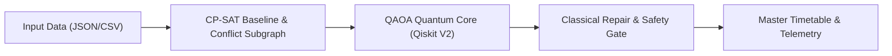

<div align="center">

# QUANTA — Quantum-Assisted Timetabling & Allocation

**VTU-QFF-HC-0076** &nbsp;|&nbsp; Tier: **Both**

</div>

---

<div align="center">

| | |
| :--- | :--- |
| **Team** | Quantify |
| **Team ID** | VTU-QFF-HC-0076 |
| **Tier** | Both |
| **Repository** | [vtu-hc-quantify](https://github.com/vtu-qiskit-fall-fest-2026/vtu-hc-quantify.git) |
| **Organisation** | [vtu-qiskit-fall-fest-2026](https://github.com/vtu-qiskit-fall-fest-2026) |
| **Event** | VTU-QFF Hackathon — VTU-Qiskit Fall Fest 2026 |

</div>

---

## 📌 Table of Contents

- [Team Members](#-team-members-github-ids)
- [Problem Statement](#-problem-statement)
- [Proposed Solution](#-proposed-solution)
- [Approach & Architecture](#-approach--architecture)
- [Tech Stack](#-tech-stack)
- [Project Structure](#-project-structure)
- [How to Run](#-how-to-run)
- [How to Push Code](#-how-to-push-code)
- [Submission Checklist](#-submission-checklist)
- [Resources](#-resources)
- [License](#-license)

---

## 👥 Team Members (GitHub IDs)

> Members are added to this repository as **collaborators** and must accept the
> GitHub invitation before they can push. Add your GitHub username below.

| # | Name | GitHub Username | Role |
| :-- | :--- | :--- | :--- |
| 1 | Yash B Koparde | [@yashkoparde](https://github.com/yashkoparde) | Team Lead |
| 2 | Aditya Patange | [@AdityaPatangez](https://github.com/AdityaPatangez) | Developer |
| 3 | Melwin Fernandes | [@Melwin-2007](https://github.com/Melwin-2007) | Developer |

---

## ❓ Problem Statement

**Problem:** University examination timetabling is an NP-hard combinatorial optimization problem requiring the assignment of hundreds of course exams across limited time slots and examination halls. Schedules must satisfy strict hard constraints (preventing overlapping student exams and exceeding room capacities) while optimizing soft constraints (maximizing exam spacing and minimizing back-to-back student testing fatigue).

**Why it matters:** Manual scheduling and standalone heuristics struggle with densely coupled interdisciplinary course electives, leaving administrators in weeks of manual conflict resolution and forcing students into exhausting back-to-back exams. Conversely, pure quantum optimization approaches fail at university scale due to NISQ-era qubit limits, transpilation depth, and hardware noise.

**Track / Category:** Online / Offline · Quantum Cloud-Based Applications (Hybrid Combinatorial Optimization)

---

## 💡 Proposed Solution

**Solution:** **QUANTA** is an IBM Quantum-powered hybrid examination scheduling platform that integrates industrial classical constraint programming (**Google OR-Tools CP-SAT**) with parameterized quantum optimization (**Qiskit QAOA**). Rather than forcing an entire campus schedule onto a quantum processor, QUANTA computes a guaranteed feasible global baseline classically, isolates dense conflict-heavy course bottlenecks into compact subproblems, and optimizes them across local Qiskit simulators and IBM Quantum Processing Units (QPUs).

**Key idea:** Graph-decomposed hybrid optimization combining Google OR-Tools CP-SAT global constraint solving with QUBO-to-Ising QAOA refinement and an automated classical repair/fallback safety gate.

**Why this works:** By bounding the quantum search to extracted conflict subgraphs ($8\text{–}12$ binary variables), circuits stay shallow enough to execute on current NISQ hardware, while a deterministic classical post-processing gate guarantees 100% hard-constraint compliance even when quantum hardware measurements are noisy.

---

## 🧩 Approach & Architecture



1. **Input** — Structured JSON/CSV datasets containing university courses, student enrollment mappings, physical examination rooms with seating capacities, available time slots, and configurable soft-constraint penalty multipliers ($\lambda_{\text{assign}}, \lambda_{\text{conflict}}, \lambda_{\text{spacing}}$).
2. **Preprocessing** — Google OR-Tools CP-SAT generates a verified global baseline schedule to act as a deterministic fallback. A `NetworkX` graph analyzer builds the student co-enrollment conflict matrix, identifies high-friction soft-constraint clusters, and carves out the densest bottleneck subgraph into an unconstrained binary quadratic (QUBO) model mapped to a Pauli-$Z$ Ising Hamiltonian (`SparsePauliOp`) via $x_k \mapsto \frac{I - Z_k}{2}$.
3. **Quantum Core** — A $p$-layer parameterized **Quantum Approximate Optimization Algorithm (QAOA)** ansatz (`QAOAAnsatz`) alternating the diagonal cost Hamiltonian $U(H_C, \gamma)$ and transverse-field mixer $U(H_M, \beta)$. Circuits are transpiled to target hardware topology and optimized in a hybrid variational loop (COBYLA/SPSA) using Qiskit V2 primitives (`EstimatorV2` and `SamplerV2`) on `qiskit-aer` (ideal and noisy models) and physical IBM Quantum QPUs.
4. **Post-processing** — Sampled bitstrings (`2,048` shots) are decoded back into discrete `(Course, Slot, Room)` assignments. A deterministic classical repair heuristic resolves minor one-hot assignment collisions, and an acceptance gate compares the hybrid candidate's global soft-penalty score against the OR-Tools baseline—deploying the quantum-refined schedule only if it maintains zero hard violations and strictly improves schedule quality.
5. **Output** — An interactive dark-mode engineering console displaying the conflict-free Master Timetable Grid, resolved student clash diffs, QAOA variational energy convergence plots, transpiled circuit telemetry (qubit count, depth, 2Q ECR/CX gates), and a reproducible 3-Way Empirical Benchmark report (**OR-Tools vs. Qiskit Simulator vs. IBM QPU**).

---

## 🛠️ Tech Stack

| Layer | Technology |
| :--- | :--- |
| Language | Python 3.11+ |
| Quantum SDK | Qiskit `>=1.0`, Qiskit Aer, Qiskit Runtime |
| Optimisation | Qiskit Optimization / COBYLA / SPSA |
| Simulation | AerSimulator (statevector / noisemodel) |
| Environment | JupyterLab / VS Code, `venv` |
| Version control | Git + GitHub |

---

## 📁 Project Structure

```text
vtu-hc-quantify/
├── README.md                          # Master documentation, architecture & quickstart
├── AGENTS.md                          # Standing rules for AI pair-programming agents
├── STATUS.md                          # Live task & handoff tracker (A0-A6, B0-B6, C1-C6)
├── Makefile                           # Unified dev commands (setup, dev, mock, test, bench)
├── requirements.txt                   # Unpinned Python 3.11+ dependencies
├── .env.example                       # IBM Quantum token & server configuration
├── backend/
│   ├── schemas.py                     # Frozen Pydantic v2 data models (single source of truth)
│   ├── core/                          # Classical Optimization Engine (Member A)
│   │   ├── datagen.py                 # Synthetic campus dataset generator (Zipfian electives)
│   │   ├── baseline.py                # Google OR-Tools CP-SAT global baseline solver
│   │   ├── scorer.py                  # Pure-Python independent constraint validator
│   │   ├── extractor.py               # NetworkX conflict matrix & bottleneck cluster extractor
│   │   └── repair.py                  # Classical repair heuristic & acceptance fallback gate
│   ├── quantum/                       # Variational Quantum Algorithms (Member B)
│   │   ├── qubo.py                    # QUBO formulation & Ising Hamiltonian mapping
│   │   ├── bitorder.py                # Little-endian bitstring normalization helper
│   │   ├── qaoa.py                    # Parameterized QAOA loop (EstimatorV2, COBYLA/SPSA)
│   │   ├── noise.py                   # AerSimulator noise models (depolarizing, thermal, readout)
│   │   ├── ibm.py                     # IBM Quantum QPU execution & FakeBackend offline fallback
│   │   └── interface.py               # Thread-safe run_quantum() public facade
│   ├── api/                           # REST API & Worker Lifecycle (Member A)
│   │   ├── main.py                    # FastAPI application with mock mode & role-based access
│   │   ├── jobs.py                    # BackgroundTasks worker & SQLite status tracker
│   │   └── db.py                      # SQLAlchemy 2.0 job database model
│   └── tests/                         # Pytest test suite (<5s execution time on fixtures)
│       └── test_schemas.py            # Schema validation and constraint tests
├── frontend/                          # High-density dark-mode web console (Member C)
│   ├── package.json                   # React 18, Vite, Tailwind, Recharts, Lucide
│   ├── src/
│   │   ├── api.ts                     # Typed API client for FastAPI backend
│   │   ├── types.ts                   # TypeScript schemas mirrored from Pydantic
│   │   ├── pages/                     # Dataset, Timetable, Cluster Lab, Benchmarks
│   │   ├── components/                # D3 conflict graph, Recharts traces, TanStack tables
│   │   └── theme.css                  # Industrial design tokens (no gradients, 2px borders)
├── benchmarks/                        # Empirical comparative evaluation engine
│   ├── run_benchmarks.py              # CP-SAT vs Brute Force vs QAOA (Ideal / Noisy / QPU)
│   ├── results.csv                    # Raw benchmark data across 10 random seeds
│   └── figs/                          # Generated plots: approx ratio, depth, noise sweeps
├── data/                              # Datasets and test fixtures
│   ├── fixtures/                      # Static fixtures: mini/ dataset, subproblem_6/12 JSONs
│   └── synthetic/                     # Generated campus benchmarks (4,200 students, 180 courses)
├── runs/                              # Execution logs, cached runs & hardware telemetry JSONs
│   └── hardware/                      # Physical IBM QPU raw job counts and metrics
├── scripts/
│   └── e2e.py                         # Headless end-to-end pipeline verification script
├── docs/                              # Engineering contracts, math specs, PRD, and demo guides
├── tasks/                             # Member-specific task prompts (A_backend, B_quantum, C_frontend)
└── handoffs/                          # Formal inter-member async handoff protocols (HO-01 to HO-06)
```

---

## 🚀 How to Run

### Prerequisites

- Python 3.11 or newer
- [Git](https://git-scm.com/downloads)
- A GitHub account (you need collaborator access to this repo)

### 1. Clone the repository

```bash
git clone https://github.com/vtu-qiskit-fall-fest-2026/vtu-hc-quantify.git
cd vtu-hc-quantify
```

### 2. Create a virtual environment

```bash
python3 -m venv .venv
source .venv/bin/activate        # Linux / macOS
# .venv\Scripts\activate         # Windows (PowerShell)
```

### 3. Install dependencies

```bash
pip install --upgrade pip
pip install -r requirements.txt
```

### 4. Run

```bash
python -m src.main
```

Or launch the notebook workflow:

```bash
jupyter lab
```

### 5. Run the tests

```bash
pytest -q
```

---

## 🔁 How to Push Code

> Full walkthrough: **[Git & Collaboration Handbook](../vtu-hc-guide-git-and-collaboration)** — collaboration
> workflow, branches, pull requests, reviews and conflict resolution.

### Configure Git (first time only)

```bash
git config --global user.name  "Your Name"
git config --global user.email "you@example.com"
```

### Everyday workflow

```bash
# 1. Get the latest changes
git checkout main
git pull origin main

# 2. Create a branch for your work
git checkout -b feature/my-task

# 3. Commit your work
git add .
git commit -m "feat: add variational circuit for the search problem"

# 4. Push the branch
git push -u origin feature/my-task

# 5. Open a Pull Request on GitHub and request a review
#    https://github.com/vtu-qiskit-fall-fest-2026/vtu-hc-quantify/compare/main...feature/my-task

# 6. After approval, merge into main
git checkout main
git pull origin main
git branch -d feature/my-task
```

### Commit message convention

| Prefix | Meaning |
| :--- | :--- |
| `feat:` | New feature |
| `fix:` | Bug fix |
| `docs:` | Documentation only |
| `test:` | Adding or fixing tests |
| `refactor:` | Code restructure, no behaviour change |
| `chore:` | Build/config/dependency changes |

### Useful commands

```bash
git status              # what changed
git log --oneline -10   # recent commits
git diff                # review changes before committing
git stash               # shelve changes temporarily
git pull --rebase       # update your branch on top of main
```

### Collaborating on the same repo

- **Never push directly to `main`** — open a Pull Request.
- **Pull before you push** to avoid rejected commits.
- **Commit often** with clear messages.
- **Resolve conflicts** locally: `git pull --rebase`, fix the files, then `git add` + `git rebase --continue`.
- **Ask for a review** before merging — a second pair of eyes catches bugs fast.

---

## ✅ Submission Checklist

- [ ] Repository created and **public**
- [ ] All team members added as **collaborators** and invitations accepted
- [x] `README.md` updated with project details, problem statement and solution
- [x] Team members listed under [Team Members](#-team-members-github-ids)
- [ ] `requirements.txt` committed and project runs from a clean clone
- [ ] Code pushed to `main` and the latest `main` builds successfully
- [ ] Notebooks committed with **cleared outputs** (or use `nbstrip`)
- [ ] `README` includes a demo screenshot / video link
- [ ] Short project summary submitted on the hackathon portal

---

## 📚 Resources

| Resource | Link |
| :--- | :--- |
| 🔁 Git & collaboration handbook | [Git & Collaboration Handbook](../vtu-hc-guide-git-and-collaboration) |
| ❓ Problem statements, solutions & terms | [Problem Statements, Solutions & Terms](../vtu-hc-guide-problem-and-solution) |
| 📄 README writing guide | [README Guide & Template](../vtu-hc-guide-readme-template) |
| ⚛️ Qiskit documentation | https://docs.quantum.ibm.com/ |
| ⚛️ Qiskit Runtime & primitives | https://quantum.cloud.ibm.com/docs/ |
| 🧪 Qiskit Aer simulator | https://docs.quantum.ibm.com/guides/simulator |
| 💻 IBM Quantum Platform | https://quantum.cloud.ibm.com/ |
| 🎓 Qiskit textbook | https://qiskit.qotlabs.org/learning/ |
| 📋 GitHub Docs | https://docs.github.com/ |

---

## 📄 License

Released under the [MIT License](LICENSE). See `LICENSE` for details.

---

<div align="center">

**Quantify** · Team ID `VTU-QFF-HC-0076` · Tier `Both`
· Built with ⚛️ Qiskit for the VTU-QFF Hackathon

[⬆ Back to Top](#quanta--quantum-assisted-timetabling--allocation)

</div>
